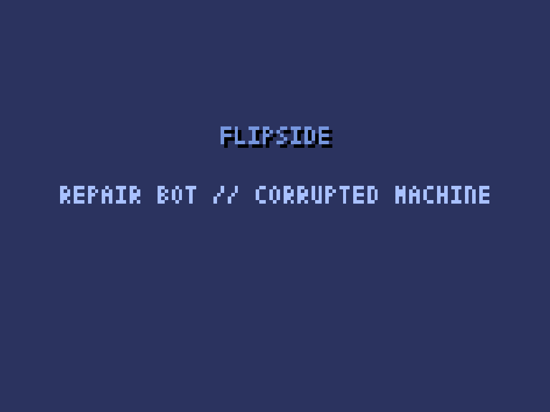
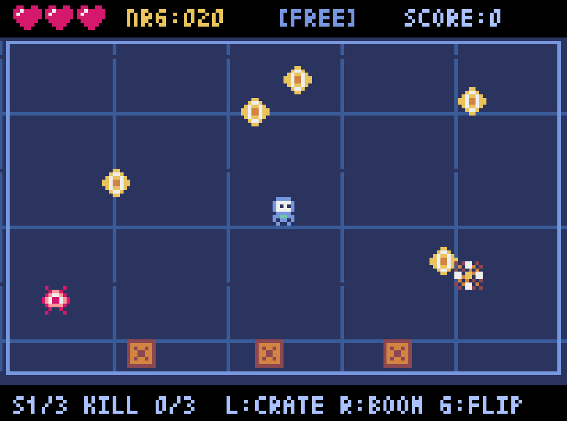
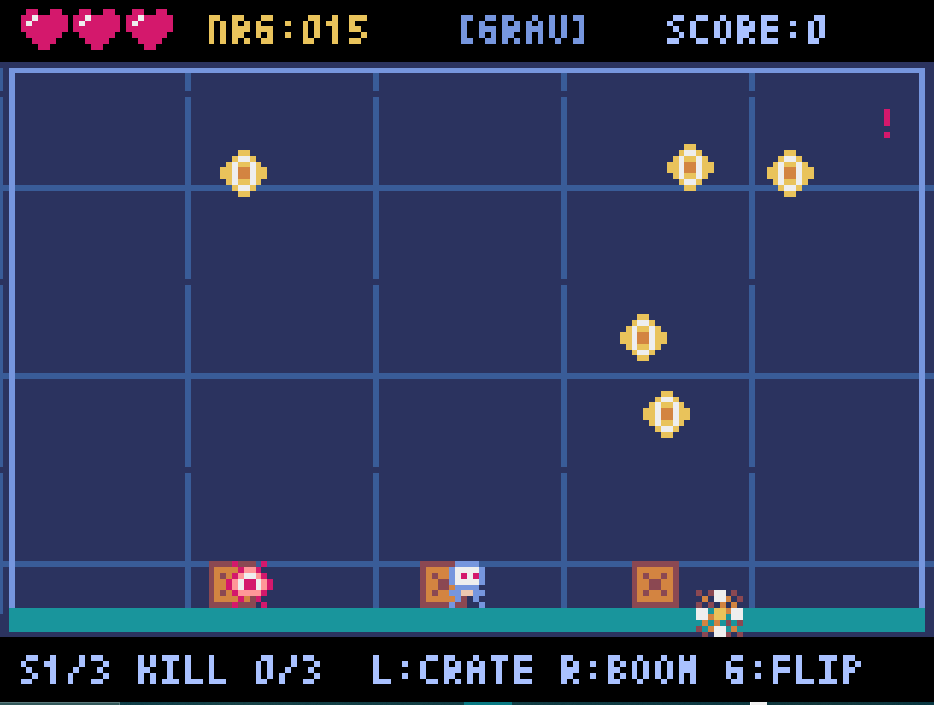

# FLIPSIDE

A one-screen 16-color arcade game built on [Pyxel](https://github.com/kitao/pyxel) for the PromptCraft Final Round.

You are **FLIPBOT**, a repair bot inside a corrupted machine. Two physics share one arena: **FREE** (top-down) and **GRAV** (side-view with gravity). Press **G** and everything with weight falls — including the crates you place and the drones hunting you. Flip gravity so your crates drop and crush the drones, clear all 3 sectors, and restore the system.

## Screenshots







**Video demo:** VIDEO_LINK_HERE

## How to Play

| Input | Action |
| :--- | :--- |
| Arrow Keys / WASD | Move |
| SPACE | Shockwave in FREE mode (pushes + stuns) / Jump in GRAV mode |
| G | Flip physics (FREE <-> GRAV), costs 5 NRG |
| Left Click | Place a crate at the cursor, costs 15 NRG (max 6) |
| Right Click | Detonate the crate nearest the cursor (28px blast) |
| TAB | Telemetry / palette debug overlay |
| R | Return to title |
| ESC | Quit |

**Loop:** Collect orbs (+10 NRG) -> spend NRG on crates and flips -> flip so crates fall and crush drones -> each kill drops an orb and scores (+100, combos +50). Survive 3 sectors: BOOT (3 kills), CACHE (5), KERNEL (7). Hearts (+1 HP, max 5) drop from 15% of kills. Touching a drone costs 1 HP; at 0 HP the system fails. Your hi-score is saved in `highscore.json`.

## Run Instructions

Requires **Python 3.10+**.

```bash
pip install -r requirements.txt
python main.py
```

Useful flags: `python main.py --sector 2` (start at a sector), `python main.py --smoke` (headless 150-frame self-test).

## PromptCraft Section

FLIPSIDE was built in 4 prompted steps on top of the PIXELBOX starter, with the full engineering log in [`PROMPTS.md`](PROMPTS.md) and the working contract in [`AGENT_RULES.md`](AGENT_RULES.md):

1. **Foundation + state machine** — TITLE/PLAY/CLEAR/WIN/OVER dispatch, CLI flags, SFX channel split.
2. **Drones, damage, death** — spawn markers, dual-mode AI, invulnerability, knockback, death flow.
3. **Flip + crates + crush** — NRG economy, crush kills, combos, shockwave stun, detonation, ghost preview.
4. **Final push** — sector progression, hi-score persistence, six new chiptune SFX, juice (flip ring, hit-stop, particle caps).

**What worked:** hard rules up front (palette, font metrics, channel split, "edit surgically", "must run after every step") kept every step shippable; per-step `py_compile` + `--smoke` self-tests caught a broken `reset()` split within one run. Prompting for tunables-as-constants made balance changes one-line edits. **What didn't:** smoke tests alone missed logic regressions, so we added headless stub-pyxel harnesses that drive the real game logic — they caught RNG flakiness the 150-frame smoke never saw.
